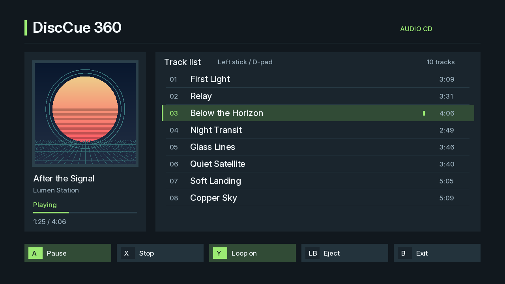
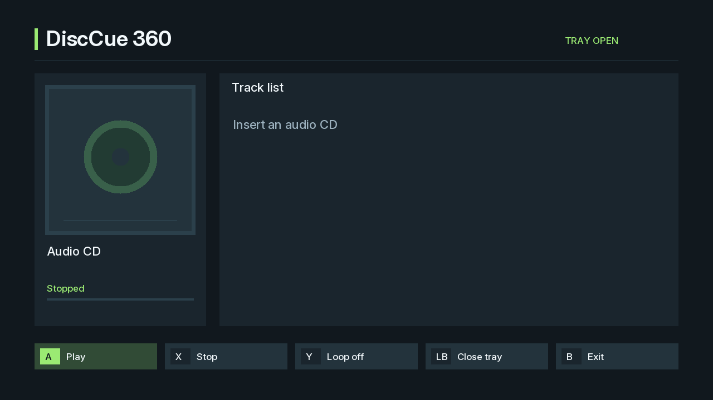

# DiscCue 360


Play physical audio CDs on an RGH Xbox 360, with track names and cover art from a helper on your LAN. Playback works offline and requires no Xbox Live account.

[Install on Xbox](#install-on-xbox) · [Set up the helper](#set-up-the-helper) · [Deploy on Linux](deploy/README.md) · [Controls](#controls)



*Rendered from DiscCue’s UI code using a sample album.*

<details>
<summary>See the tray-open screen</summary>



</details>

## Install on Xbox

1. Set up the [xsdk toolchain](https://github.com/xenosworks/xsdk/blob/9e6de98f6b5d737bce0fecd2864edae94bdd2637/docs/GETTING_STARTED.md) on Linux or WSL. Set `XSDK_ROOT` to your xsdk checkout and `XSDK_TOOLCHAIN` to the compiler install directory. From this repository, run:

   ```sh
   make -C "$XSDK_ROOT" -j"$(nproc)" \
     TOOLCHAIN="$XSDK_TOOLCHAIN/bin/powerpc-xsdk-elf-" build/libxsdk.a
   cmake -S . -B build -G Ninja \
     -DCMAKE_TOOLCHAIN_FILE="$XSDK_ROOT/cmake/xsdk.cmake" \
     -DXSDK_TOOLCHAIN="$XSDK_TOOLCHAIN"
   cmake --build build --target default
   ```

2. Copy `build/default.xex` to `Hdd1:\Apps\DiscCue360\` over FTP and open it in XEXMenu.
3. For a stock dashboard shortcut, use [QuickBoot](https://digiex.net/threads/quickboot-2-1-download-create-dashboard-shortcuts-to-xex-apps-and-games.10876/) to point a Games entry at `\Apps\DiscCue360\default.xex`.

## Set up the helper

1. On a computer on the same LAN, install Python 3. On Linux, install Pillow for cover conversion, such as `sudo apt install python3-pil` on Debian and Ubuntu. On macOS, the helper uses the built-in `sips`.
2. Set `HELPER_LAN_IP` to that computer’s LAN IPv4 address and run the helper from the repository:

   ```sh
   python3 helper.py --bind "$HELPER_LAN_IP" --cache-dir ./cache
   ```

3. Put the same address on one line in `helper-ip.txt` beside `default.xex` on the Xbox. The helper listens on TCP port `13660`. Open DiscCue and insert an audio CD.

The helper sends the disc’s track layout to MusicBrainz and gets artwork from Cover Art Archive. It saves successful matches and artwork on disk and preserves existing cache files. The [Linux deployment guide](deploy/README.md) covers starting at boot and using an HTTP proxy.

## Controls

| Button | Action |
| --- | --- |
| Left stick / D-pad | Select a track |
| A | Play, pause or resume |
| X | Stop |
| Y | Toggle repeat |
| LB | Open or close the tray |
| B / Back | Exit |

DiscCue supports audio-only CDs. Metadata coverage varies by pressing. The experimental `PlayCD` target has no verified stock dashboard redirect.
